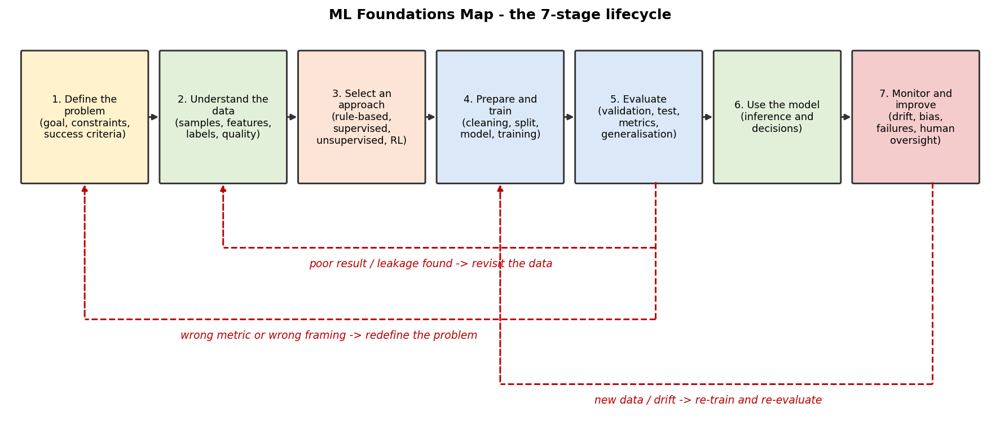
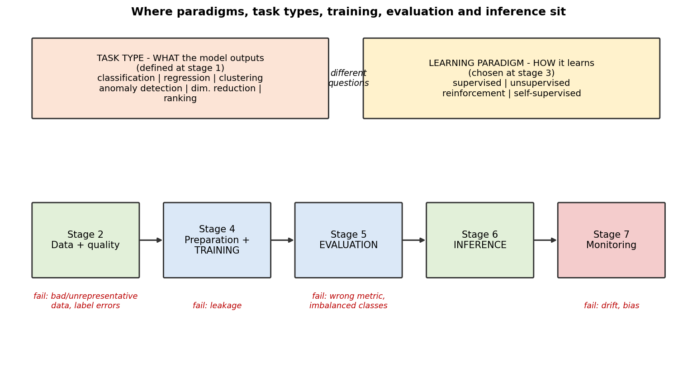

# Week 02 — Machine Learning Foundations

VLSIGuru · AI Literacy Layer · Week 02  
Author: Vishwachetan Kittali (ECE Graaduate, New Horizon College of Engineering, Bengaluru)

> Build the mental map before building the model.

## Central question
How does a computer move from examples and data to a model that can recognise patterns, make predictions or help choose actions?

## Contents
| File | What it covers |
|---|---|
| [ml_mental_map.png](evidence/mission_01_concept_map.png) | AI → ML → DL → GenAI/LLM concept map |
| [mission_01_ai_ml_landscape.md](mission_01_ai_ml_landscape.md) | AI vs rule-based vs ML, landscape |
| [mission_02_data.md](mission_02_data.md) | Data, features, labels, quality, 8-row dataset |
| [mission_03_learning_approaches.md](mission_03_learning_approaches.md) | Supervised / unsupervised / RL / self-supervised |
| [mission_04_ml_tasks.md](mission_04_ml_tasks.md) | Task types, 8 classified problems |
| [mission_05_model_anatomy.md](mission_05_model_anatomy.md) | Algorithm vs model vs parameters, training vs inference, linear regression |
| [mission_06_evaluation.md](mission_06_evaluation.md) | Data splits, overfitting, imbalanced-class worked example |
| [mission_07_failure_modes.md](mission_07_failure_modes.md) | Three failure analyses |
| [mission_08_when_to_use_ml.md](mission_08_when_to_use_ml.md) | Rule-based vs ML trade-offs |
| [mission_09_semiconductor_case_study.md](mission_09_semiconductor_case_study.md) | DRC-hotspot / congestion prediction case study |
| [sources.md](sources.md) | Sources and the claims each supports |
| [reflection.md](reflection.md) | Final reflection |

## ML Foundations Map (lifecycle)

### Where the main ideas sit on the lifecycle

### Three or more ways an ML project can fail (mapped to stages)
1. **Bad / unrepresentative data** (step 2) — model learns the wrong pattern.
2. **Data leakage** (steps 2/4/5) — evaluation looks great, reality is poor.
3. **Wrong metric / imbalanced classes** (step 5) — accuracy hides failures.
4. **Data drift** (step 7) — the world changes after deployment.
5. **Wrong problem framing** (step 1) — ML was not needed, or the target was not what the business needed.

### Semiconductor application on the map
**DRC-hotspot / routing-congestion prediction from placement data** (Mission 9) — supervised, image-like regression/classification task; main limits: needs labelled routed designs, may not transfer to new designs/nodes, wrong predictions need human/tool verification.

## Honest note on method
I used AI as a learning aid, then checked claims against the sources listed in `sources.md`. See `reflection.md`.
