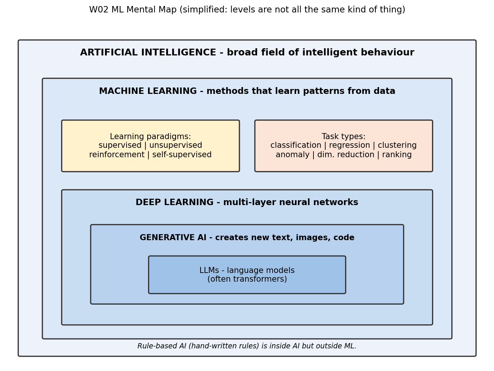

# Mission 1 — The AI and ML Landscape

**Research question:** What is artificial intelligence, and where exactly does machine learning fit?

## 1. Concept map

(Same map is also exported as `ml_mental_map.png` in this folder. Note: generative AI is a capability defined by output, so the levels are not all the same kind of thing.)

## 2. AI vs rule-based programming vs ML
| | Conventional program | Rule-based AI | Machine learning |
|---|---|---|---|
| Who writes the logic? | Programmer | Expert encodes rules | Algorithm infers it from examples |
| Input to the builder | Rules + data → answers | Expert rules + facts → answers | Data + answers → rules (a model) |
| Changes when | Code is edited | Rules are edited | Model is retrained on new data |
| Good for | Clear, stable logic | Expert decision logic | Patterns too complex to write as rules |
| VLSI example | A script that checks if WNS < 0 | "If utilisation > 85 % flag as risky" | Model that predicts timing failure from many design features |

## 3. Five distinctions (own words)
1. **AI is the goal, ML is one way to reach it.** AI is the broad aim of getting machines to do tasks that seem intelligent; ML is a method where the behaviour is learned from data instead of written by hand.
2. **Automation is not AI.** A script that runs synthesis every night is automated, but it follows fixed steps and learns nothing. It only becomes AI-like if it makes judgement-type decisions.
3. **AI does not always mean ML.** A chess engine using hand-coded search and evaluation rules, or an expert system with if-then rules, is AI without learning from data.
4. **Deep learning is a kind of ML, not a competitor to it.** It is ML using many-layered neural networks. Simpler ML (linear regression, decision trees) is still ML and is often enough.
5. **Generative AI and LLMs sit at a different level of description.** "Generative" says what a system produces (new content); "LLM" says what it is (a large language model). Most are built with deep learning, but "generative" is not a separate rung on the same ladder as "ML".

## 4. Programmed vs learned
| Explicitly programmed | Learned from data |
|---|---|
| Data loading, formatting, file handling | The relationship between features and the target |
| The model structure/algorithm choice | Parameter values (weights, split thresholds) |
| The loss/metric definition | Patterns such as "high congestion + high utilisation → fail" |
| Safety checks and fallbacks | Internal representations (in deep learning) |

## 5. Three examples classified
| Example | Class | Reason |
|---|---|---|
| Nightly shell script that runs the RTL-to-GDSII flow | Automation only (not AI) | Fixed steps, no decision-making or learning |
| Spam filter trained on labelled emails | AI **and** ML | Learned the spam pattern from examples |
| Expert-system rule "if fanout > 50 insert buffer" | AI (rule-based), **not** ML | Rule written by a human; nothing learned from data |

## 6. What remains unclear
- Where exactly the boundary between "complex automation" and "AI" sits — different sources draw it differently.
- Whether to treat generative AI as a subset of deep learning or as a category defined by output; I treat it as defined by what it produces.

