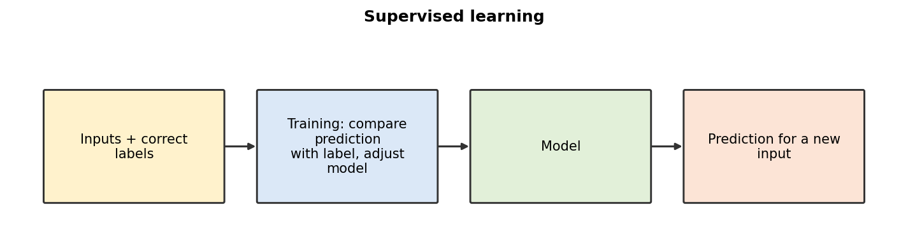
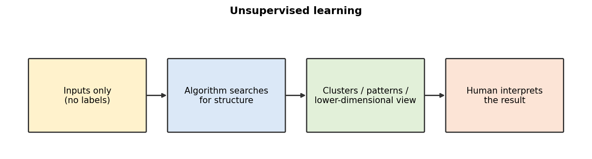
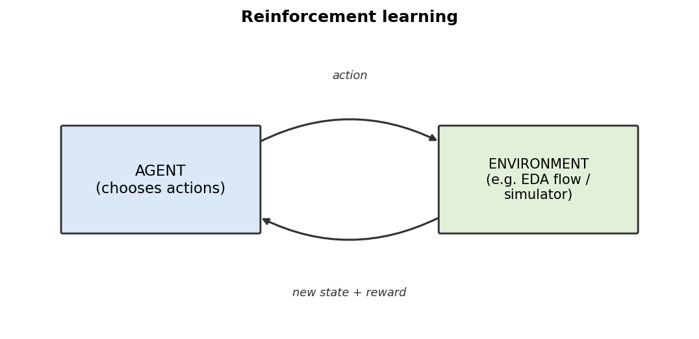
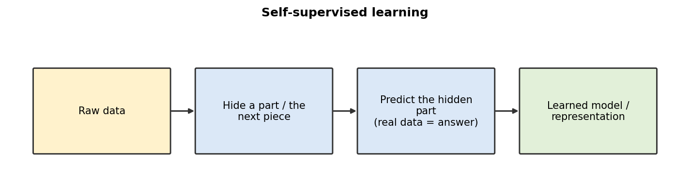

# Mission 3 — The Main ML Approaches

**Research question:** How does a system learn when it has labels, no labels, or feedback from actions?

## 1. Comparison table
| | Supervised | Unsupervised | Reinforcement | Self-supervised |
|---|---|---|---|---|
| Training signal | Correct answers (labels) | None supplied; structure in the data | Reward from actions in an environment | Targets made from the data itself |
| Produces | A model mapping inputs → predictions | Groups, patterns, compact representations | A policy (which action to take in a state) | A model/representation that can be reused |
| Example (VLSI) | Predict timing pass/fail from run features | Group similar P&R runs | Explore floorplan/design choices with a PPA-based reward | Hide part of a netlist/log/RTL text and predict it |
| Limitation | Needs many reliable labels | No guarantee groups are meaningful; hard to evaluate | Needs many trials, a well-designed reward; can exploit the reward | Needs lots of data/compute; result still must be checked for the real task |
| Key question | What target should be predicted? | What structure exists? | Which actions achieve the goal? | What signal can be created from the data? |

## 2. Simple diagrams
**Supervised**

**Unsupervised**

**Reinforcement**

**Self-supervised**

## 3. Self-supervised vs unsupervised
Both use no human-written labels, but they are not identical. Classic unsupervised learning (e.g. clustering) looks for structure in the data with no prediction target. Self-supervised learning **creates a prediction target from the data** (e.g. predict a masked word), then trains like supervised learning. So in many contexts it is considered its own approach, though some sources group it under unsupervised because no human labels are needed. (Deeper treatment is reserved for later weeks.)

## 4. When is each suitable?
- **Supervised:** you have (or can get) trustworthy labelled history and a clear target — e.g. past runs with sign-off results.
- **Unsupervised:** you want to explore or group data and have no labels — e.g. discover families of failing runs.
- **Reinforcement:** a sequence of decisions where you can simulate/score outcomes cheaply — e.g. placement or tuning with a reward. Costly if each evaluation is a full EDA run.
- **Self-supervised:** plenty of raw data, few labels — learn general patterns first, then adapt.
