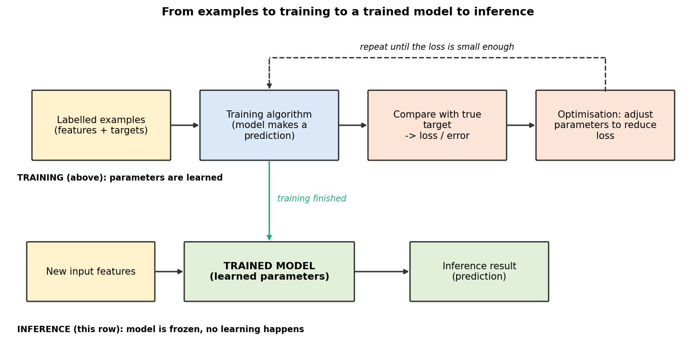

# Mission 5 — Anatomy of an ML Model

**Research question:** What happens between feeding data into an ML system and receiving a prediction?

## 1. Algorithm vs model vs parameters
| Term | Meaning | Analogy |
|---|---|---|
| Algorithm | The learning procedure/recipe (e.g. linear regression fitting, decision-tree building) | The method of studying |
| Model | The result of running the algorithm on data; what makes predictions | The knowledge you end up with |
| Parameters | Numbers inside the model learned from data (e.g. slope and intercept) | The specific values written in your notes |
*(Hyperparameters, e.g. tree depth, are settings chosen by the engineer before training — they are not learned.)*

## 2. Training vs inference
- **Training:** the model sees examples with answers and its parameters are adjusted.
- **Inference:** the trained model is frozen and applied to a **new** input to give a prediction; no learning from the answer happens at this moment.

## 3. Flow diagram

## 4. Loss and optimisation — intuition
- **Loss (error):** one number saying how wrong the predictions are, e.g. average gap between predicted and actual delay. Smaller is better.
- **Optimisation:** the process of repeatedly changing the parameters in the direction that reduces the loss, like adjusting a knob while listening to see if the sound gets clearer. (No calculus needed here; gradient-based learning comes in later weeks.)
- Different ML methods learn differently — a decision tree does not tweak knobs the same way a neural network does.

## 5. Linear regression (conceptually)
Idea: find the straight-line relationship between an input and a numeric outcome from examples, then use it for new inputs.

Illustrative (synthetic) example — **net length vs wire delay**:

| Net length (µm) | Delay (ps) |
|---|---|
| 100 | 12 |
| 200 | 22 |
| 300 | 33 |
| 400 | 41 |

The model learns something like `delay ≈ 0.10 × length + 2`. Here the **slope (≈0.10)** and **intercept (≈2)** are the learned parameters. Training picks the line that makes the overall error smallest. For a new net of 250 µm, inference gives ≈ 27 ps.
With several features it becomes `prediction = w1·x1 + w2·x2 + … + b`, with one weight per feature.

Limits: it assumes a roughly linear relationship, can be thrown off by outliers, and is only trustworthy within the range of data it has seen (wire delay actually grows non-linearly for long unbuffered wires).

## 6. Unclear
How different loss functions change what a model "cares about" — to explore in Week 03.
