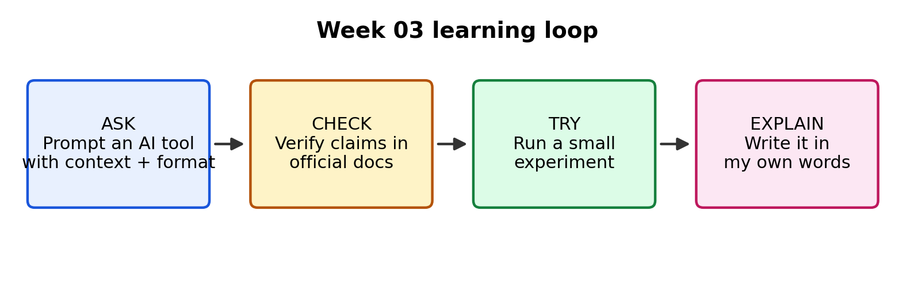

# Week 03 — Practical AI Tools & Engineering Learning

**Course:** VLSIGuru AI Literacy Layer  
**Track:** Physical Design (PD)  
**Theme:** Using AI tools as learning assistants, verifying claims, and investigating one open-source VLSI tool

## What this week covered

| Mission | What I did | Status |
|---|---|---|
| 1. Finish W01 and W02 | [Fill in: what you revisited or completed] | [Done / In progress] |
| 2. Continue CS50P | [Fill in: current week/problem set] | [In progress] |
| 3. Explore AI tools | Tried [tools you actually used]; refined prompts; compared tools; verified a claim | Done |
| 4. Open-source VLSI tool | Investigated OpenROAD / OpenROAD-flow-scripts | Done |
| 5. Record learning | Files listed below | Done |

## Files in this folder

| File | Contents |
|---|---|
| [ai_tools_exploration.md](ai_tools_exploration.md) | Tools used, prompt refinements, tool comparison, one verified claim |
| [vlsi_tool_investigation.md](vlsi_tool_investigation.md) | OpenROAD investigation: purpose, inputs/outputs, what I tried, where AI/ML helps |
| [reflection.md](reflection.md) | What I learned, what is unclear, questions for the ML masterclass |
| `images/` | PNG diagrams used in the notes |

## How AI helped me this week

I used AI tools to explain concepts, improve my prompts and quiz me. I checked important claims against official documentation, and I wrote the notes and explanations in my own words. No confidential RTL, netlists, constraints or proprietary EDA material was uploaded to any public AI service.

## Working principle

**ASK → CHECK → TRY → EXPLAIN.** AI speeds up learning, but I own my understanding and my engineering decisions.
