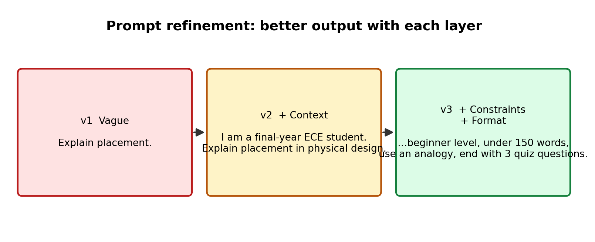

# AI Tools Exploration — Week 03

## 1. Tools I explored

| Tool | What I used it for | Verdict |
|---|---|---|
| ChatGPT | [e.g. beginner explanation of a PD concept] | [one line] |
| Claude | [e.g. explanation, quiz, gap finding] | [one line] |
| NotebookLM | Asked questions about my W02 assignment and an intro ML source; opened cited passages | [one line] |
| Perplexity | Researched a technical question and followed citations to primary sources | [one line] |


## 2. Prompt refinement



### Example 1 — Beginner-friendly explanation

**v1 (vague):**
```
Explain placement.
```
**Problem:** Answer was generic; unclear whether it meant chip placement, cell placement, or something else.

**v2 (added context):**
```
I am a final-year ECE student learning VLSI physical design.
Explain what placement means in the RTL-to-GDSII flow.
```
**Improvement:** Answer became specific to physical design.

**v3 (added constraints and output format):**
```
I am a final-year ECE student learning VLSI physical design.
Explain cell placement in the RTL-to-GDSII flow in under 150 words,
at beginner level, using one real-world analogy.
Then give me 3 quiz questions to test my understanding.
```
**Improvement:** Short, structured, and followed by a self-test.

**What I learned:** Context, constraints and an output format made the biggest difference. [Replace with your own words and your real outputs.]

### Example 2 — Finding gaps in my understanding

```
Quiz me one question at a time on static timing analysis basics
(setup, hold, slack). Wait for my answer, then tell me what I got
wrong and why. Do not give the next question until I answer.
```
**Result:** [What happened, what gaps it exposed.]

### Example 3 — Add your own
```
[Your prompt]
```
**Result:** [What changed]

## 3. Comparing two tools on the same question

**Question used:** [e.g. "What is the difference between global placement and detailed placement?"]


| Aspect | Tool A: [name] | Tool B: [name] |
|---|---|---|
| Clarity | [ ] | [ ] |
| Depth | [ ] | [ ] |
| Gave sources? | [ ] | [ ] |
| Anything wrong or doubtful? | [ ] | [ ] |

**Observation:** [2–3 sentences: where they agreed, where they differed, which you trusted more and why.]

## 4. NotebookLM experiment

- **Sources loaded:** my W02 assignment and [name of intro ML source]
- **Question answered by the sources:** [question] → I opened the citation and it [did / did not] support the answer.
- **Question NOT covered by the sources:** [question] → The tool [declined / answered anyway / hedged].
- **Takeaway:** [e.g. grounded tools are safer for study, but still need citation checks.]

## 5. One claim I verified

| Item | Detail |
|---|---|
| **Claim from AI** | [Exact claim, e.g. "OpenROAD uses TritonCTS for clock tree synthesis."] |
| **Tool that said it** | [Tool name] |
| **Source I checked** | [Official doc URL, e.g. the OpenROAD documentation page for CTS] |
| **What the source says** | [Your own words] |
| **Conclusion** | [Correct / partly correct / incorrect, and why] |

**Lesson:** A citation does not automatically mean a claim is correct. I opened the source and confirmed the wording supported the claim.

## 6. Safety practices I followed

- Treated AI answers as suggestions to investigate, not proof
- Checked important claims against official documentation
- Uploaded no confidential RTL, netlists, constraints or proprietary EDA material
- Reviewed any AI-generated code before running it
