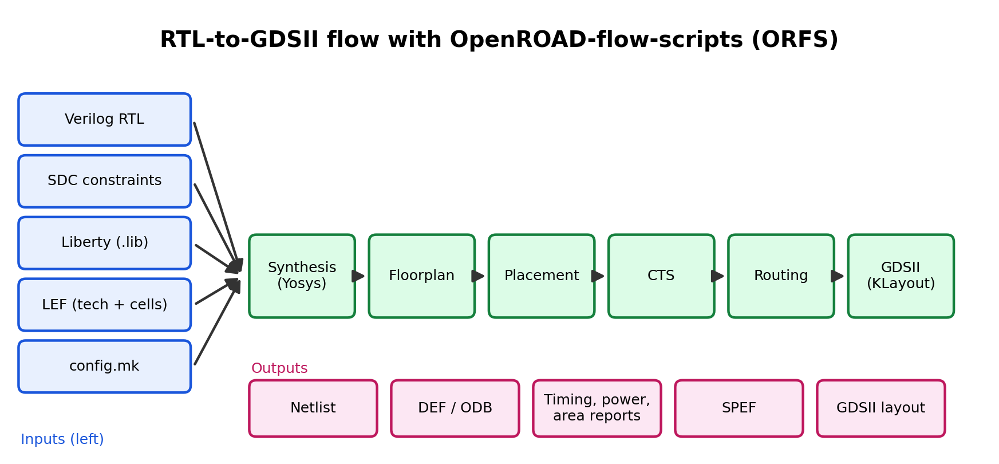

# Open-Source VLSI Tool Investigation — OpenROAD

**Track:** Physical Design  
**Tool:** OpenROAD, used through OpenROAD-flow-scripts (ORFS)  
**Official sources:** OpenROAD documentation and the OpenROAD-flow-scripts documentation (links: [https://openroad.readthedocs.io/en/latest/])

## 1. What problem does it solve?

Turning a synthesized design into a manufacturable layout normally needs expensive commercial tools. OpenROAD is an open-source, automated RTL-to-GDSII flow. It covers floorplanning, placement, clock tree synthesis, routing and timing analysis, so students and researchers can explore the whole physical design flow without a commercial licence.

OpenROAD-flow-scripts wraps OpenROAD with Yosys (logic synthesis) and KLayout (layout viewing and GDS handling) into one runnable flow.

## 2. Flow overview



## 3. Main inputs and outputs

| Inputs | Purpose |
|---|---|
| Verilog RTL | The design to implement |
| SDC constraints | Clock definitions and timing constraints |
| Liberty (.lib) | Cell timing and power models |
| LEF files | Technology and standard-cell physical abstracts |
| config.mk | Design and flow settings (platform, utilization, clock period, etc.) |

| Outputs | Purpose |
|---|---|
| Gate-level netlist | Result of synthesis |
| DEF / ODB | Floorplan, placement and routing database |
| Reports | Timing, power, area, congestion |
| SPEF | Extracted parasitics |
| GDSII | Final layout |

> Verify exact file names and stage outputs against the ORFS documentation for the version you ran.

## 4. Flow stages in my own words

| Stage | What it does |
|---|---|
| Synthesis | Converts RTL into a gate-level netlist using the standard-cell library |
| Floorplan | Sets die/core size, aspect ratio, and the power grid |
| Placement | Decides where each standard cell sits; global then detailed placement |
| CTS | Builds the clock distribution network to control skew |
| Routing | Connects the pins with metal layers; global then detailed routing |
| Final | Timing and DRC checks, and GDSII generation |

[Rewrite these in your own words after reading the docs.]

## 5. What I tried

**Setup:** [e.g. Docker / local build / Linux or WSL]  
**Design:** [e.g. a small example design shipped with ORFS such as gcd]  
**Platform:** [e.g. nangate45]  
**Command I ran:**
```
[exact command you ran, copied from the ORFS documentation]
```
**What I observed:**
- [Stage logs I saw]
- [A timing number or report I looked at, e.g. worst slack]
- [Layout opened in KLayout or the OpenROAD GUI]

**Problems I hit and how I solved them:** [Short notes]

> If your setup could not run it this week, say so honestly and describe what you read and explored instead, such as the documentation, flow scripts and example config files.

## 6. Where AI/ML could help (related PD tasks)

| PD task | How AI/ML could help | Caveat |
|---|---|---|
| Flow parameter tuning | Search better settings (utilization, placement density, clock period) automatically instead of trial and error | Each run is costly; results are design-specific |
| Congestion / routability prediction | Predict hotspots before routing, saving iterations | Needs good training data |
| Timing prediction | Estimate post-route timing early in the flow | Accuracy depends on the technology |
| Placement and floorplanning | Learning-based approaches to improve wirelength or macro placement | Active research; claims need careful verification |
| Learning and debugging | Explain log messages and error output | Verify against docs; do not paste proprietary data |

I plan to read the OpenROAD documentation to confirm which of these directions the project itself supports, rather than trusting this table as fact. [Add what you find.]

## 7. Summary

- **Learned:** [Your key takeaway]
- **Still unclear:** [Your open questions]
